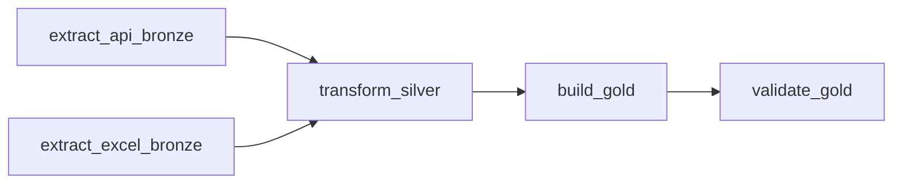

# Proyecto ETL: Calidad del Aire en India (Arquitectura Medallion + Apache Airflow)

**Autor:** Santiago Navia Soto

---

## 1. ¿De qué trata este proyecto?

Este proyecto implementa un pipeline **ETL (Extracción, Transformación y Carga)** bajo la **Arquitectura Medallion (Bronze, Silver y Gold)**, automatizado cada hora con **Apache Airflow**, para analizar la calidad del aire en **763 estaciones de monitoreo de India** combinando dos fuentes independientes:

1. **Archivo Excel (`AIR_QUALITY_INDIA_DATASET.xlsx`):** catálogo de estaciones físicas en India (ubicación, sensores instalados y fechas de operación).
2. **API REST de Open-Meteo (modelo Copernicus CAMS):** niveles horarios de contaminación del aire (`PM2.5`, `PM10`, `NO2`, `SO2`, `CO`, `O3` e índice `EAQI`) en las coordenadas de esas estaciones.

---

## 2. ¿Cómo funciona la Arquitectura Medallion?

Los datos avanzan por tres capas de menor a mayor calidad:

* **Capa Bronze (Datos Crudos):**
  Guarda los datos originales sin alterarlos: el archivo Excel (verificando en cada corrida su huella digital `SHA-256`), el archivo `bronze_aire_india_api.json` con las respuestas crudas de la API y un respaldo histórico por corrida en `data/bronze/runs/<run_id>/`.
* **Capa Silver (Datos Limpios e Integrados):**
  * **Sensores (`silver_aire_india_sensores.csv`):** conserva únicamente sensores de contaminantes del aire (descarta variables de clima como temperatura o humedad), corrige unidades dañadas (`ug/m3`), elimina duplicados y calcula los días de operación.
  * **Horario (`silver_aire_india_horario.csv`):** limpia la serie horaria de la API, anula valores negativos imposibles, interpola huecos temporales y une cada estación del Excel con su celda horaria.
* **Capa Gold (Indicadores y KPIs Finales):**
  * **`gold_final.csv`** *(y su copia compatible `gold_aire_india.csv`)*: resume **una fila por estación y día**, combinando la capacidad instalada de sensores con promedios/máximos diarios de contaminantes, el índice europeo (**EAQI**), el índice oficial de India (**NAQI - CPCB**) y los rankings diarios.
  * **`tabla_kpi_resumen.csv`:** resumen ejecutivo de los **5 KPIs ambientales (Green Data)** con definición, fórmula, columnas y resultados.
  * **`reporte_coordenadas_compartidas.csv`:** control de qué estaciones vecinas comparten la misma celda de consulta en la API.

---

## 3. Automatización Horaria con Apache Airflow (Docker)

Para que el proceso corra solo **cada hora en punto (`0 * * * *`)** sin intervención manual, el pipeline está orquestado en **Apache Airflow 3.3.2** mediante el DAG **[`dags/etl_green_data_hourly.py`](dags/etl_green_data_hourly.py)**.

### Las 5 tareas del flujo en Airflow
1. **`extract_api_bronze`** *(en paralelo)*: consulta la API REST de Open-Meteo por lotes y guarda el JSON crudo en Bronze.
2. **`extract_excel_bronze`** *(en paralelo)*: lee el Excel de estaciones, verifica su versión (`SHA-256`) y respalda una copia intacta de la corrida.
3. **`transform_silver`**: espera a que **ambas** extracciones terminen bien (si alguna falla, se detiene para no mezclar datos incompletos), limpia las tablas y actualiza la capa Silver.
4. **`build_gold`**: construye `data/gold/gold_final.csv`, calcula los 5 KPIs ambientales y actualiza automáticamente **PostgreSQL (`DB_GOLD_INDIA`)** si detecta el archivo `.env`.
5. **`validate_gold`**: revisa que `gold_final.csv` exista, tenga todas sus columnas, **0 filas duplicadas** y KPIs matemáticamente consistentes. Si algo falla, marca alerta en rojo.



### Contenedores, puertos y cómo abrir Airflow en el navegador
El entorno Docker Compose (ubicado en la carpeta `airflow-medallon`) levanta los servicios oficiales de Airflow (`airflow-apiserver`, `airflow-scheduler`, `airflow-dag-processor`, `airflow-worker`, `airflow-triggerer`, `postgres` interno de Airflow y `redis`) montando este proyecto en `/opt/airflow/medallon`:

* **Interfaz Web de Airflow:** **[http://localhost:8080](http://localhost:8080)** (puerto `8080`, usuario/contraseña por defecto `airflow` / `airflow`).
* **PostgreSQL Data Warehouse (Windows local):** puerto `5432`, base de datos `DB_GOLD_INDIA` (Airflow se conecta automáticamente usando `host.docker.internal:5432`).
* **Zonas horarias:** el planificador de Airflow trabaja en **`UTC`** y los datos horarios de contaminación se piden en hora local de India (**`Asia/Kolkata`, UTC+05:30**).

Comandos básicos desde la carpeta `airflow-medallon`:
```powershell
docker compose up -d      # Encender Apache Airflow
docker compose ps         # Verificar que los contenedores estén saludables (healthy)
docker compose down       # Apagar los contenedores cuando termines
```
Dentro de `http://localhost:8080`, busca el DAG **`etl_green_data_hourly`**, actívalo con el interruptor y presiona **Trigger DAG** (o deja que se ejecute solo cada hora al minuto `:00`).

---

## 4. Estructura de Carpetas del Proyecto

```text
medallon/
├── config/config.yaml                  # Parámetros de rutas, API, zonas horarias y umbrales de calidad
├── dags/
│   └── etl_green_data_hourly.py        # DAG declarativo de Apache Airflow (5 tareas, cron 0 * * * *)
├── data/
│   ├── bronze/                         # Datos crudos (Excel + JSON API + snapshots por corrida)
│   ├── silver/                         # Datos limpios (sensores + serie horaria integrada)
│   └── gold/                           # gold_final.csv, tabla_kpi_resumen.csv y reporte de celdas
├── evidencias/                         # Pruebas verificables P1 a P5 (estructura, cron, fallo y re-ejecución)
├── logs/
│   ├── log.txt                         # Registro detallado paso a paso
│   └── run_summary.json                # Métricas verificables de la última corrida
├── notebooks/notebook.ipynb            # Análisis exploratorio y visualizaciones (EDA)
├── scripts/
│   ├── generar_evidencias_p1_p5.py     # Reproduce y verifica automáticamente las pruebas P1–P5
│   └── empaquetar_entrega.ps1          # Empaqueta el proyecto limpio en .zip (sin venv ni .env)
├── src/
│   ├── extract/                        # Extracción Excel (con SHA-256) y API REST (con reintentos)
│   ├── transform/                      # Limpieza Silver, cálculo NAQI India y armado de Gold
│   ├── quality/                        # Validaciones de esquema, claves, cobertura y KPIs
│   ├── load/                           # Carga idempotente (UPSERT) hacia PostgreSQL (DB_GOLD_INDIA)
│   ├── utils/                          # Configuración YAML, logger y lectura/escritura incremental
│   └── pipeline_tasks.py               # Funciones modulares invocadas por las 5 tareas del DAG
├── tests/                              # Suite de 117 pruebas automatizadas con pytest
├── INFORME_CORTO_LABORATORIO.md        # Informe técnico corto del laboratorio (2–4 páginas)
├── main.py                             # Ejecución directa por consola (completa o --solo-gold)
├── .env.example                        # Plantilla de variables de entorno (sin credenciales reales)
└── requirements.txt                    # Dependencias Python del pipeline
```

---

## 5. Instalación y Ejecución Local (sin Docker)

### Paso 1: Crear entorno e instalar librerías
```powershell
python -m venv .venv
.\.venv\Scripts\Activate.ps1
pip install -r requirements.txt
pip install -r requirements-dev.txt
```
*(No necesitas ninguna `API_KEY` para Open-Meteo porque es abierta y gratuita. Si deseas carga automática a PostgreSQL, copia `.env.example` a `.env` con los datos de tu base local).*

### Paso 2: Ejecutar el pipeline manualmente si lo deseas
* **Corrida completa (Bronze $\rightarrow$ Silver $\rightarrow$ Gold $\rightarrow$ Validación $\rightarrow$ PostgreSQL):**
  ```powershell
  python main.py
  ```
* **Regenerar únicamente Gold, KPIs y validación desde Silver (sin consultar internet):**
  ```powershell
  python main.py --solo-gold
  ```

### Paso 3: Ejecutar las pruebas automatizadas y evidencias
```powershell
pytest --cov=src --cov=main
python scripts/generar_evidencias_p1_p5.py
```

---

## 6. Aspectos Clave de los Datos y PostgreSQL

* **Modelo por celda (~11 km) vs. estación física:** Open-Meteo entrega el valor modelado por Copernicus CAMS para cuadros de $0.1^\circ$ ($\sim 11\text{ km}$). De las **763 estaciones**, se consultan **460 celdas únicas** y **427 estaciones** en ciudades densas comparten celda con estaciones cercanas (documentado en `reporte_coordenadas_compartidas.csv` y `distancia_modelo_km`, media **4.19 km**).
* **Doble índice de calidad del aire (EAQI + NAQI India):** además del índice europeo (`aqi_promedio_dia`), se calcula el índice oficial de India (`naqi_india_promedio_dia`, escala 0–500 de CPCB) junto con su contaminante crítico (`contaminante_dominante_naqi`).
* **Tablas y vistas en pgAdmin (`DB_GOLD_INDIA`):** la carga crea y mantiene al día sin duplicados la tabla `gold_aire_india` y las vistas analíticas `vw_dim_estaciones`, `vw_fact_calidad_aire_diaria` y `vw_top_peor_aire`.
* **Informe detallado y pruebas P1–P5:** consulta **[`INFORME_CORTO_LABORATORIO.md`](INFORME_CORTO_LABORATORIO.md)** para el análisis técnico completo y la carpeta **[`evidencias/`](evidencias/)** para los registros de prueba del laboratorio.
