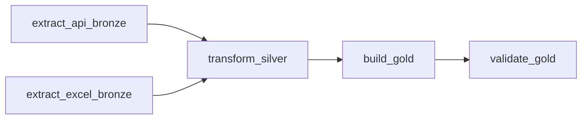

# Evidencia P1 — Estructura del DAG y Grafo de Dependencias

- **Fecha de verificación (UTC):** `2026-11-04T03:31:21+00:00`
- **Archivo del DAG:** `dags/etl_green_data_hourly.py`
- **Estado de importación:** `OK (0 errores de sintaxis / importación)`
- **Identificador (`dag_id`):** `etl_green_data_hourly`
- **Expresión de planificación (`schedule`):** `0 * * * *`
- **Fecha de inicio fija (`start_date`):** `2026-10-01T00:00:00`
- **`catchup`:** `False`
- **`max_active_runs`:** `1`
- **Política de reintentos (`default_args`):** `retries=2`, `retry_delay=0:05:00`
- **Etiquetas (`tags`):** `['ETL', 'medallion', 'green-data']`

## Las 5 tareas del flujo y sus dependencias

1. **`extract_api_bronze`** *(raíz paralela 1)*: extrae contaminantes horarios de Open-Meteo y guarda JSON crudo en Bronze y en `data/bronze/runs/<run_id>/`.
2. **`extract_excel_bronze`** *(raíz paralela 2)*: lee `AIR_QUALITY_INDIA_DATASET.xlsx`, calcula su hash `SHA-256` y respalda copia inalterada en `data/bronze/runs/<run_id>/`.
3. **`transform_silver`** (`trigger_rule="all_success"`): depende de **ambas** extracciones; si cualquiera falla, no se ejecuta.
4. **`build_gold`**: depende de `transform_silver`; genera `data/gold/gold_final.csv`, calcula 5 KPIs ambientales y sincroniza PostgreSQL (`DB_GOLD_INDIA`).
5. **`validate_gold`**: depende de `build_gold`; valida existencia, esquema, unicidad de claves y consistencia matemática de los KPIs.
